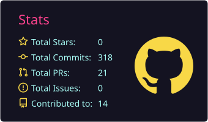
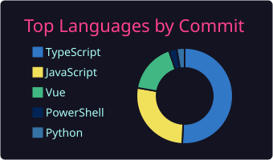
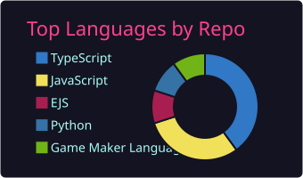
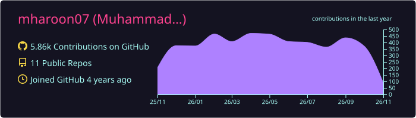
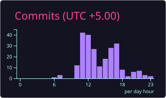

  

  

<h2 align="center">PLAYER PROFILE</h2>

  

<h2 align="center">LOADOUT</h2>

<h4 align="center">Languages &amp; Core</h4>

  
  
  
  
  

<h4 align="center">Frameworks &amp; Libraries</h4>

  
  
  
  

<h4 align="center">Databases &amp; Cloud</h4>

  
  
  

<h2 align="center">STATS &amp; PROGRESS</h2>

  
  

 

  
  

 

  

<h2 align="center">CONTRIBUTION SNAKE</h2>

  

<h2 align="center">NIGHT SHIFT</h2>

  

  

  
  

  

